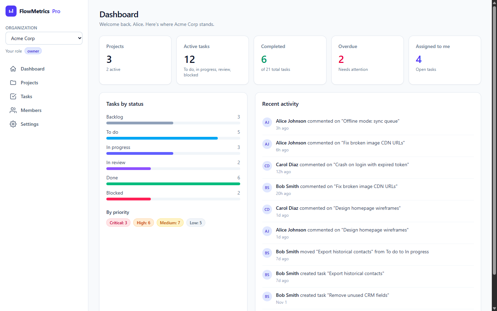
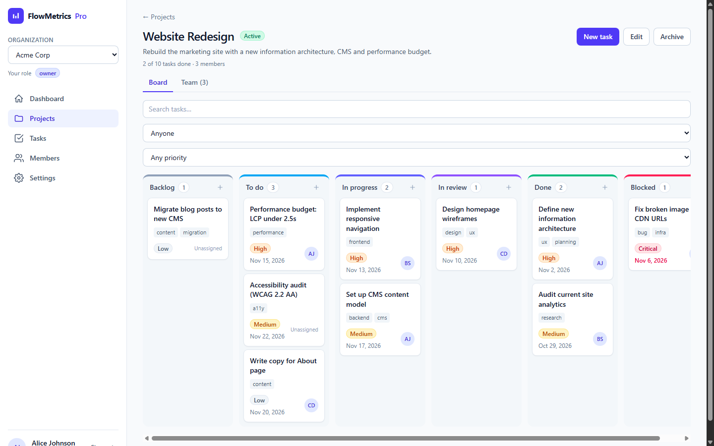
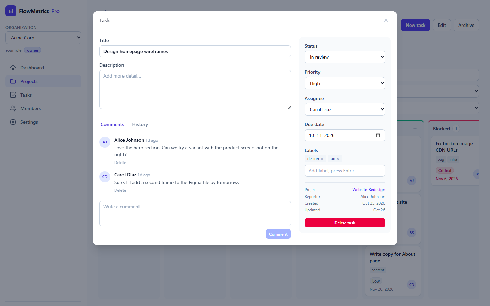

# FlowMetrics Pro

[](https://github.com/AkhilRudrapaka/FlowMetrics-Pro/actions/workflows/ci.yml)

**A multi-tenant project and task management SaaS with strict organization-level data isolation, server-enforced role-based access control, and a drag-and-drop Kanban board.** Go + React + MongoDB, one command to run.



| Kanban board | Task detail |
| --- | --- |
|  |  |

## Quick start (Docker, about 3 minutes)

You need [Docker Desktop](https://docs.docker.com/get-docker/) (or Docker Engine with Compose v2), **running**. Nothing else.

```bash
git clone https://github.com/AkhilRudrapaka/FlowMetrics-Pro.git
cd FlowMetrics-Pro
cp .env.example .env            # Windows PowerShell: Copy-Item .env.example .env
docker compose up --build
```

Then open **http://localhost:3000**. Demo data loads automatically on the first start.

- The first build downloads images and takes 2 to 3 minutes. Later starts take seconds.
- Add `-d` to run in the background, then `docker compose ps` should show all three services `healthy`.
- Stop: `Ctrl+C` (or `docker compose down`). Your data stays in a Docker volume. Start over from scratch: `docker compose down -v`.
- Port 3000 busy? Set `WEB_PORT` in `.env`.

Verified end to end on Docker Desktop for Windows (Engine 29, Compose 5): clean build, first-run seeding, restart with data intact, and a MongoDB restart under a live API.

<details>
<summary>No Docker? Run the pieces directly (Go 1.26+, Node 20.19+ or 22.12+, a MongoDB)</summary>

```bash
# terminal 1: API on :8080
cd backend
export MONGO_URI="mongodb://localhost:27017" JWT_SECRET="$(openssl rand -hex 32)" SEED_ON_START=true
go run ./cmd/server

# terminal 2: UI on :5173 (proxies /api to :8080)
cd frontend && npm install && npm run dev
```

PowerShell: `$env:MONGO_URI="mongodb://localhost:27017"; $env:JWT_SECRET=-join((1..32)|%{'{0:x2}' -f (Get-Random -Max 256)}); $env:SEED_ON_START="true"; go run ./cmd/server`
</details>

## Demo accounts

Password for every account: **`Password123!`** (also shown on the login page in the Docker demo build)

| Email | Role | Belongs to |
| --- | --- | --- |
| `alice@acme.test` | **Owner** | **Acme Corp** (owner) and **Globex Inc** (member) |
| `bob@acme.test` | **Admin** | Acme Corp |
| `carol@acme.test` | **Member** | Acme Corp |
| `dave@globex.test` | **Owner** | **Globex Inc** only, a completely separate tenant |

### A 2-minute tour

1. **Sign in as Alice.** She belongs to two organizations, so you get the picker. Open *Acme Corp*, then the *Website Redesign* project, and **drag a card** to another column. Refresh the page: it stays.
2. **Open a task.** Edit fields, comment, check the History tab. Try the organization switcher in the sidebar.
3. **Sign out, sign in as Carol (member).** *New project*, *Edit*, *Archive* and the danger zone are hidden, and the server would refuse them anyway.
4. **Sign in as Dave.** He sees only Globex. Paste an Acme URL from earlier: **"Not found"**, the same answer as for a page that never existed.
5. **Register a new account.** You get an empty workspace; create an organization, a project and a task to see the first-run flow. A user with one organization goes straight into it on every later login.

## Key features

**Multi-tenancy.** Users create and belong to any number of organizations. Every project, task, comment and audit entry belongs to exactly one organization and is unreachable from any other.

**Role-based access control** (`owner`, `admin`, `member`), enforced on the server for every request:

| | Owner | Admin | Member |
| --- | :-: | :-: | :-: |
| View everything in the organization | ✓ | ✓ | ✓ |
| Create / edit / archive projects; manage project teams | ✓ | ✓ | |
| Create and edit tasks, comment | ✓ | ✓ | in projects they belong to |
| Delete tasks | any | any | their own |
| Add / remove regular members | ✓ | ✓ | |
| Add admins, change roles, delete the organization | ✓ | | |

**Kanban and tasks.** Six statuses, drag-and-drop with optimistic updates (rolled back on failure) or a status dropdown for keyboard and touch use. Priority, assignee, due date, labels, comments, and a per-task change history.

**More.** Projects with archive/restore (archived = read-only) and per-project teams. A dashboard with active / completed / overdue counts, "assigned to me", status and priority breakdowns and a live activity feed. Server-side search, filters, sorting and pagination. Rate-limited sign-in. Loading skeletons, empty and error states, toasts, and a layout that works down to phone width.

## Tech stack

| | |
| --- | --- |
| **Backend** | Go, [Gin](https://github.com/gin-gonic/gin), official MongoDB Go driver v2 |
| **Frontend** | React 19, TypeScript, Vite, Tailwind CSS v4, Zustand, TanStack Query |
| **Database** | MongoDB |
| **Auth** | JWT access tokens + rotating opaque refresh tokens, bcrypt |
| **Ops** | Docker, Docker Compose, nginx, GitHub Actions |
| **Tests** | Go unit and integration tests on a real MongoDB; Vitest |

## Architecture highlights

Full write-up with diagrams: [docs/architecture.md](docs/architecture.md).

- **Layered backend.** `handler` (HTTP only) → `service` (rules and authorization) → `repository` (the only code that touches MongoDB). All permissions live in one table, `internal/permissions`.
- **Roles come from the database, not the token**, so removing a member or changing a role takes effect on their very next request.
- **Sessions.** The 15-minute access token lives only in browser memory. The refresh token is opaque, stored hashed, delivered in an `httpOnly` `SameSite=Strict` cookie, rotated on every use, and replaying a spent token revokes the whole session. Logout revokes it server-side.
- **Single origin.** nginx serves the UI and proxies `/api`, so the strict cookie works with no CORS setup, under a strict Content-Security-Policy.
- **Hardened containers.** Distroless backend and unprivileged nginx, both non-root. MongoDB is authenticated and published to localhost only; the API isn't published at all. Health-gated startup (`depends_on: service_healthy`) means a cold start can't race the database.
- **Fail-fast config.** The API refuses to start without a strong `JWT_SECRET` and rejects placeholder secrets in production. No secrets are in the repo; `.env` is git-ignored.

## How tenant isolation works

The requirement: *a user in one organization must never reach another organization's data.* It is enforced at four independent points, so one mistake is not enough to cause a leak.

1. **A gate on every tenant route.** All data routes live under `/orgs/:orgId/...`. One middleware looks up the caller's membership `(org, user)` in the database; no membership ends the request with **404** before any handler runs. The handlers receive an `Actor{user, org, role}` and have no way to name a different organization.
2. **Repositories can't forget the tenant.** Every method on tenant-owned data takes an `orgID` and builds its filter through one helper:
   ```go
   func scoped(orgID bson.ObjectID, extra bson.M) bson.M  // always includes {org_id: orgID}
   ```
   There is no `FindTaskByID(id)`; it is `Get(ctx, orgID, id)`.
3. **404, not 403, and identical answers.** A non-member, someone else's id and a nonexistent id all return the same response, so ids and the existence of other tenants can't be probed.
4. **Cross-references are checked inside the org.** A user from another tenant can't be added to a project or assigned a task.

**How it is tested.** The integration suite fires 20 routes at another organization's id (all must be 404), then uses its *own* org with *another tenant's* project, task and comment ids and asserts the response equals a nonexistent id's. It also checks that lists and the dashboard stay empty. As a sanity check, deleting the `org_id` filter from `scoped()` makes these tests fail, and the broken build lets an outsider delete another tenant's organization.

## Tests and CI

```bash
cd backend && MONGO_TEST_URI=mongodb://localhost:27017 go test ./...   # integration tests need a MongoDB
cd frontend && npm test
```

GitHub Actions runs on every push: gofmt, vet and the full Go suite (race detector on) against a real MongoDB; frontend typecheck, tests and build; then it builds the Docker images, starts the whole stack, and smoke-tests login, seeded data and tenant isolation through nginx.

## Known limitations

- **Adding people needs an existing account** (by email); there is no emailed-invitation flow yet.
- **Logout revokes the refresh token, not the access token**, so a stolen access token stays valid for up to 15 minutes.
- **MongoDB runs as a single node**, so a couple of multi-step operations use compensating steps instead of transactions.
- **The Kanban board doesn't remember card order within a column** (cards sort by priority, then recency) and loads a project's 100 most recently updated tasks.
- **Search is a substring match**, not ranked full-text search.

## Future improvements

- Emailed invitations with expiring tokens; email verification and password reset
- Access-token revocation (session id in the token, checked against the session store)
- MongoDB replica set with transactions; ranked full-text search
- Manual card ordering within a column
- Real-time updates (WebSockets or SSE) with optimistic-concurrency checks
- Subtasks, dependencies, attachments, saved filters; optional TOTP two-factor auth
- OpenAPI spec generated from the handlers; browser end-to-end tests in CI
- Metrics and tracing (Prometheus, OpenTelemetry)

## More

- [docs/architecture.md](docs/architecture.md): design, security decisions, trade-offs
- [docs/api.md](docs/api.md): endpoint reference
- [docs/configuration.md](docs/configuration.md): every environment variable
- Layout: `backend/` (Go API: `cmd/`, `internal/{handler,service,repository,permissions,auth,middleware,...}`), `frontend/` (React app), `docs/`, `.github/workflows/`, `docker-compose.yml`
