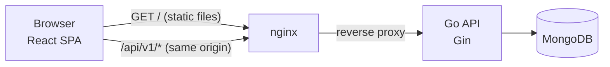
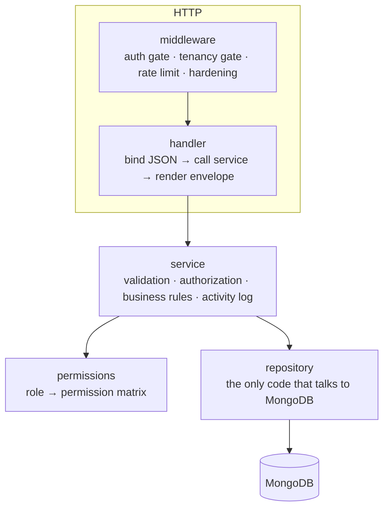
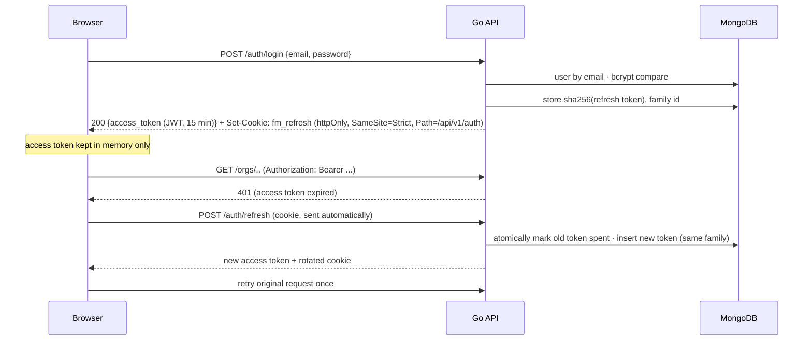

# Architecture

## System overview



The browser only ever talks to **one origin**. nginx serves the static bundle and reverse-proxies `/api/` to the Go service (in development, Vite's dev server does the same). This is a deliberate security decision, not a convenience: it lets the refresh-token cookie be `SameSite=Strict` and removes the need for CORS (and the mistakes that come with it).

## Backend layers



| Layer | Responsibility | Must **not** |
| --- | --- | --- |
| `handler` | Decode request, call one service method, render the response envelope | Contain rules or authorization decisions |
| `service` | Validate input, enforce permissions and invariants, write the audit trail | Import `net/http` or Gin |
| `repository` | Build queries and map to/from documents | Decide who may do what |
| `permissions` | One table mapping roles to permissions | Know about HTTP or the database |

Errors cross layers as a single `*apperr.Error` (status, stable `code`, message, per-field `details`). Anything else is treated as a bug: logged with context and returned to the client as a generic 500.

## Tenant isolation

The requirement: *a user in one organization must never reach another organization's data.* It is enforced at four independent points so that one mistake is not enough to cause a breach.

1. **Tenancy gate (middleware).** All tenant routes live under `/orgs/:orgId/...` behind `OrgScope`. It looks up the membership `(org_id, user_id)` in the database. No membership means the request ends with **404**. Handlers below it receive an `Actor{UserID, OrgID, Role}` and have no way to name a different organization.
2. **Scoped repositories.** Every method on a tenant-owned collection requires an `orgID` and builds its filter through one helper:
   ```go
   func scoped(orgID bson.ObjectID, extra bson.M) bson.M  // always includes {org_id: orgID}
   ```
   There is no `FindTaskByID(id)` to call by accident; it's `Get(ctx, orgID, id)`. All tenant-leading indexes start with `org_id`, so isolation also makes queries fast.
3. **Indistinguishable failures.** A non-member, a foreign id, and a nonexistent id all produce the same 404 body, so ids and organization existence cannot be probed. (A *403* is used only where the caller is a legitimate member who lacks a role or project permission.)
4. **Cross-references are validated.** Adding a user to a project or assigning a task checks the user against the *same* organization; a user from another tenant can never be attached to this tenant's data.

Roles are read from the `memberships` collection on every request, **not** carried in the JWT. Removing a member or changing a role therefore takes effect on their very next request, even if their access token is still valid.

### How this is verified

`backend/internal/handler/api_test.go` runs against a real MongoDB:

- **`TestTenantIsolation`** fires 20 routes at another organization's id (all must be 404), then uses *its own* org with *the other tenant's* project/task/comment ids and asserts the response is identical to a nonexistent id. It also checks that org-wide lists and the dashboard are empty, that foreign users can't be attached, and that removal from an org revokes access immediately.
- **Mutation check:** deleting the `org_id` filter from `scoped()` makes these tests fail, and the broken build lets an outsider delete another tenant's organization. The tests have teeth.

## Authentication & sessions



| Decision | Why |
| --- | --- |
| Access token in **memory**, never `localStorage` | An XSS bug can't steal a credential that outlives the page. A reload restores the session through the cookie. |
| Refresh token in an **httpOnly, SameSite=Strict** cookie scoped to `/api/v1/auth` | Scripts can't read it; it's never sent to other API routes; cross-site requests can't carry it (CSRF). |
| Refresh token is **opaque and hashed** (SHA-256) in the DB | A database leak yields no usable sessions. 256 bits of entropy, so salting is unnecessary. A JWT would add nothing, because the server must look it up to revoke it anyway. |
| **Rotation + reuse detection** | Each refresh spends the token. Presenting a spent token again (after a 10 s grace window for two tabs racing) revokes the whole session family: if someone stole a cookie, using it kills both parties' sessions. |
| **Atomic spend** (`UpdateOne` where `revoked_at = null`) | Two concurrent refreshes can't both succeed. |
| **Single-flight refresh** on the client | Parallel 401s (and React StrictMode's double effect) share one refresh request, so a legitimate user never trips the reuse detector. |
| Login always runs bcrypt and returns one generic error | No account enumeration via response or timing. Rate-limited per IP. |
| JWT algorithm pinned to HS256; expiry required | Defeats `alg=none` and algorithm-confusion attacks (covered by unit tests). |
| TTL index on `refresh_tokens.expires_at` | MongoDB purges expired sessions itself. |

## Roles and permissions

`internal/permissions` is the single table of what each role may do (see the README for the matrix). Role checks happen in the **service** layer, so they apply regardless of which handler or test calls it. Resource-level rules sit on top:

- **Task and comment writes** require the caller to be a project member, or an owner/admin (`ProjectWriteAny`), and the project must not be archived. This one function (`projectForWrite`) is the gate for every task mutation.
- **Delete task:** reporter or admin. **Delete comment:** author or admin.
- **Assignees** must be members of the task's project.
- **Member management** follows `CanManage(actor, target)`: the owner manages everyone but themself, admins manage only plain members, and the owner can't be removed or demoted.

## Data model

| Collection | Tenant-owned | Notes | Indexes |
| --- | :-: | --- | --- |
| `users` | no | bcrypt hash is never serialised (`json:"-"`) | `email` unique |
| `organizations` | n/a | | `_id` |
| `memberships` | yes | `(org, user, role)`; the tenancy gate reads this | `(org_id, user_id)` unique; `user_id` |
| `projects` | yes | `member_ids`, `status`, `archived_at` | `(org_id, status, updated_at)` |
| `tasks` | yes | `status`, `priority`, `assignee_id`, `due_date`, `labels`, `completed_at` | `(org_id, project_id, status)`, `(org_id, assignee_id, status)`, `(org_id, due_date)`, `(org_id, updated_at)` |
| `comments` | yes | author name is snapshotted | `(org_id, task_id, created_at)` |
| `activities` | yes | append-only audit trail; actor name and entity title are snapshotted | `(org_id, created_at)`, `(org_id, task_id, created_at)` |
| `refresh_tokens` | no | hashed token, family id, revoked/expiry | `token_hash` unique, `family_id`, TTL on `expires_at` |

Snapshotting names in comments and activity keeps the history readable after a member is removed or a task is renamed.

## Dashboard computation

All task counters come from **one** aggregation (`$match` on the org, then `$facet` for by-status, by-priority, overdue, and "mine"), so the dashboard costs one pass over the org's tasks instead of five queries. Tasks in archived projects are excluded. "Active" means `todo`, `in_progress`, `in_review`, or `blocked` (backlog isn't active work yet). "Overdue" means a due date before today (UTC) on a task that isn't done.

## Search, filtering, pagination

- Free-text search is a case-insensitive substring match on title and description. User input is passed through `regexp.QuoteMeta`, so `.*` searches for the literal characters and can't be used for ReDoS or to match everything (tested).
- Sort fields come from an allowlist; `_id` is added as a tiebreaker so pages never overlap or skip rows (tested).
- Pagination is `page`/`page_size` (max 100) with `skip/limit` and a `meta` block (`total`, `total_pages`). Skip/limit is simple and fine at this scale; cursor pagination is the upgrade for very deep pages.

## Trade-offs I'd call out in an interview

| Choice | Alternative | Why this one here |
| --- | --- | --- |
| Roles from the DB on each request | Roles in the JWT | One extra indexed read buys instant revocation. |
| 404 for non-members | 403 | Doesn't confirm that another tenant's resource exists. |
| Validation in services | `binding:` tags on request structs | One source of truth for HTTP, tests and the seeder; reports all field errors together. |
| Compensating steps, no transactions | Replica set + multi-doc transactions | Keeps the default Docker setup a single standalone node. The operations affected (create/delete org) are idempotent-safe: access is cut first and orphans are unreachable. |
| Best-effort audit log | Transactional audit log | A logging hiccup should never fail a user's action; failures are logged. Needs transactions to do strictly. |
| Regex substring search | `$text` index | `$text` matches whole stemmed words only, which feels broken for "log" → "login". Atlas Search or a text index is the upgrade. |
| In-memory rate limiter | Redis | No extra moving part; documented single-replica ceiling. |
| Native HTML5 drag-and-drop | dnd-kit | Zero dependencies; the task dialog is the keyboard/touch path. dnd-kit is the upgrade for touch dragging. |
